# staybook

Staybook is a hotel booking system, like Booking.com or Airbnb. Each level is built by hand. Level 0 is one Spring Boot app and one Postgres database. Later levels add concurrency, payments, microservices, caching, search, and load balancing.

The point is to learn system design by meeting each problem for real and fixing it, not by reading about it.



[`docs/architecture/`](docs/architecture/) holds snapshots of the design board.

## Level 0: the monolith

One Spring Boot app, one Postgres database, and a mock payment gateway running outside the app.

Services read time from the injected `Clock`. The app bean is
`Clock.systemUTC()`. The gates add a primary test clock at
`2099-01-01T00:00:00Z` beside that bean. A booking night in the gates
is 60 days after that clock. Do not call `now()` in Java or SQL.
Otherwise the gates will not see the test clock. The fixed instant is
ahead of the wall clock, so `now()` is not already past the hold.

**Modules**

| Read side | Write side |
| --- | --- |
| Search | Booking |
| Catalog | Inventory |
| Pricing | Payment |
| Reviews | Identity |

**Actors:** a Guest searches and books; a Host manages hotels in Catalog and sets pricing rules.

**The path to study:** Booking to Inventory, labelled *hold*. It is the only path that writes `inventory.reserved`, and every later level exists to keep that write correct under load.

### Entities

| Table | Columns |
| --- | --- |
| `users` | id, username (unique), email (unique), password_hash, created_at, last_logged_in |
| `hotel` | id, owner_id → users, name, city, address |
| `room_type` | id, hotel_id → hotel, name, capacity |
| `inventory` | room_type_id → room_type, date, total, reserved. Primary key (room_type_id, date), `reserved >= 0`, `reserved <= total` |
| `rate` | room_type_id → room_type, date, price |
| `booking` | id, user_id → users, room_type_id → room_type, check_in, check_out, guests, total_price_paise, status, idempotency_key (unique), request_hash, hold_expires_at, created_at |
| `payment` | id, booking_id → booking, amount_paise, payment_type, status, provider_ref (unique), idempotency_key, created_at |

Booking status is one of `HELD`, `CONFIRMED_UNPAID`, `PAID`, `CANCELLED`, `EXPIRED`. One booking can have many payments, because a failed attempt can be retried.

Money is integer paise, never a decimal. `booking.total_price_paise` and `payment.amount_paise` are `bigint`. ₹1500 is `150000`.

Reviews and amenities (`review`, `amenity`, `hotel_amenity`) come in at level 1.

### What V1 must contain

Ash's schema is the first migration,
`src/main/resources/db/migration/V1__init.sql`. The exit-gate fixtures
insert rows straight into the tables above, so the table and column
names must match. The gates also expect these in V1:

- `booking.request_hash`, a `text NOT NULL` hash of the booking
  request. It tells a retry of the same request apart from a different
  request that reuses the `idempotencyKey`.
- `CHECK (reserved >= 0)` on `inventory`.
- `CHECK (reserved <= total)` on `inventory`.
- `bigint` for `booking.total_price_paise` and `payment.amount_paise`.

### Holding a room

Availability is a counter per room type per night. A hold for check-in 20 Dec and check-out 22 Dec runs one statement:

```sql
UPDATE inventory
SET reserved = reserved + 1
WHERE room_type_id = :rt
  AND date >= :check_in AND date < :check_out
  AND reserved < total;
```

If the number of rows updated equals the number of nights, insert the booking and commit. Otherwise roll back.

### Payments

The gateway (Razorpay or Stripe later, a mock for now) is an external system behind a `PaymentGateway` interface. Payment creates an order, the guest pays on the gateway's page, and the gateway calls our webhook. The webhook can arrive late, twice, or never. The app matches it on `provider_ref`. A repeat delivery is the same payment. The gateway is never called while a database transaction is open.

## How we work

- Ash writes all of the application code, including the schema in `V1__init.sql`.
- Each level starts with a problem statement, `TODO`s, and exit-gate tests that fail until the level is solved. When they all pass, the level is cleared.
- Exit-gate tests run against a real Postgres through Testcontainers, in GitHub Actions.
- Work goes in through pull requests, reviewed before merge.

## Levels

Levels 0 to 4 run locally on Docker Compose. The rough order:

1. **Level 0:** the monolith above, working end to end.
2. **Level 1:** reviews and amenities.
3. **Level 2:** concurrency. No overbooking under parallel load, idempotent booking, and a consistency check that recounts `reserved` from bookings.
4. **Level 3:** reliable payments with an outbox.
5. **Later:** caching, search with Elasticsearch, splitting into services, load balancing, and whatever problem shows up next.

## HTTP contract

Level 0 clients talk to one app. The exit-gate tests call only the paths
below. The tests compile before those modules exist. They fail at runtime
until this contract holds.

Dates are `YYYY-MM-DD`. A stay covers `checkIn` inclusive and
`checkOut` exclusive, the same window as the hold statement above.

Primary keys are `bigint`. A fixture insert omits `id` and reads it
back with `RETURNING id`. `inventory` has no surrogate id. Its primary
key is `(room_type_id, date)`.

### Hotels

`POST /api/hotels` with:

```json
{
  "ownerId": 1,
  "name": "Harbor",
  "city": "Kochi",
  "address": "1 Beach Road"
}
```

`201` returns `id`, `ownerId`, `name`, `city`, and `address`.

`GET /api/hotels/{id}` returns that object, or `404`.

`PUT /api/hotels/{id}` with the same fields returns `200`, or `404`.

`DELETE /api/hotels/{id}` returns `204`, or `404`.

### Room types

`POST /api/room-types` with:

```json
{
  "hotelId": 1,
  "name": "Deluxe",
  "capacity": 2
}
```

`201` returns `id`, `hotelId`, `name`, and `capacity`.

`GET /api/room-types/{id}` returns that object, or `404`.

`PUT /api/room-types/{id}` returns `200`, or `404`.

`DELETE /api/room-types/{id}` returns `204`, or `404`.

### Holds

`POST /api/bookings` with:

```json
{
  "userId": 1,
  "roomTypeId": 1,
  "checkIn": "2099-03-02",
  "checkOut": "2099-03-05",
  "guests": 2,
  "idempotencyKey": "guest-1"
}
```

That sample is three nights: 2, 3, and 4 March 2099. The gates book
2 March 2099, which is 60 days after the test clock.

The `inventory` rows for those nights must already exist. The hold does
not insert them. It runs the update in "Holding a room". When the
number of updated rows equals the number of nights, insert one
`booking` with status `HELD` and commit. Otherwise roll back and return
`409`. A `409` leaves every night's `reserved` unchanged.

`201` body:

```json
{
  "id": 10,
  "userId": 1,
  "roomTypeId": 1,
  "checkIn": "2099-03-02",
  "checkOut": "2099-03-05",
  "guests": 2,
  "status": "HELD",
  "idempotencyKey": "guest-1"
}
```

The same `idempotencyKey` sent again returns `201` with the same `id`.
It does not insert a second booking, and it does not increment
`reserved` again. Ten concurrent calls with one key do the same: one
booking row, one increment, and that same id on every response.

The same `idempotencyKey` with a different request body returns `422`.
It inserts no booking and leaves `reserved` unchanged.

`POST /api/bookings/{id}/release` returns `204`. It subtracts 1 from
`reserved` on every night that booking covered. A second release of
the same booking also returns `204` and changes nothing, so `reserved`
never goes below 0.

### Check constraints

`inventory.reserved` stays between 0 and `inventory.total`. The
database rejects a row outside that range with a check constraint. The
level 0 gates insert one row above `total` and one below 0, and expect
SQLSTATE `23514` for each.

### Gateway and webhook

`PaymentGateway` is the boundary. This repo does not implement it. The
mock is WireMock. Compose publishes it on host port `8089`.

The app reads `staybook.payment.gateway-base-url` (default
`http://localhost:8089`) and creates an order with
`POST {that url}/v1/orders` after the inventory transaction has
committed. `PaymentGateway.createOrder` takes the amount in paise. A
gateway error does not roll back a hold that already committed. The
booking response may wait on the gateway. The inventory row lock must
not.

Two overlapping bookings use `total = 2` and the same room type and
dates. The order call sleeps for 5 seconds. Both transactions commit
within a second. `reserved` ends at 2. The gateway is called once per
booking.

The level 3 control shows that the one-second check catches a lock held
across the gateway call. Its first booking goes through a test-only
booking service, a `@TestConfiguration` bean in `Level3ExitGateTest`,
that calls the gateway inside the inventory transaction. Its second
booking goes through the app. One second later, `reserved` is still
below 2. The app has no such mode. No header, parameter, or setting
makes it call the gateway before commit.

Webhook: `POST /api/payments/webhook`.

`X-Payment-Signature` is the lowercase hex HMAC-SHA256 of the raw
request body. The key is `staybook.payment.webhook-secret`. The `dev`
and `test` profiles use `test-webhook-secret` when
`STAYBOOK_PAYMENT_WEBHOOK_SECRET` is unset. Any other profile does not
start without that variable.

```json
{
  "providerRef": "order_123",
  "bookingId": 1,
  "amount": 150000,
  "paymentType": "card",
  "idempotencyKey": "pay-1"
}
```

`amount` is paise, so `150000` is ₹1500.

A valid signature returns `200`. The same signed body, including five
deliveries at once, leaves one `payment` row for that `providerRef`
with status `PAID`, and moves the booking to `PAID`. Every response is
`200`. The level 3 fixture starts the booking at `CONFIRMED_UNPAID`.

A bad signature returns `401`. The booking status stays as it was, and
no payment row is written.

A correctly signed webhook whose `amount` differs from the booking's
`total_price_paise` returns `422`. It also writes no payment row and
leaves the booking status as it was. The level 3 gate sends `1500`,
rupees mistaken for paise, against a booking of `150000`.

### Exit-gate tags

`level0` runs in CI and is expected to fail until this contract and
`V1__init.sql` are in place. `level2` and `level3` are written and
switched off. See CI for how to turn a level on.

Level 2 also checks 100 concurrent bookings of one night with
`total = 5`: exactly 5 responses are `201`, the rest are `409`, and
`reserved` is 5.

Level 2 also expires holds. The gate inserts a `HELD` booking whose
`hold_expires_at` is the test clock's instant, on a night with
`total = 1` and `reserved = 1`. It then advances that clock by one
minute. A new hold on that night returns `201` with no wait. The old
booking is `EXPIRED`, and `reserved` is 1.

## Running locally

Start Postgres and the mock gateway:

```bash
docker compose up -d
```

Run the app against that Postgres with the `dev` profile. The `dev` and
`test` profiles use the database password `staybook` unless
`DB_PASSWORD` is set, and `test-webhook-secret` unless
`STAYBOOK_PAYMENT_WEBHOOK_SECRET` is set. Any other profile has no
fallback for either and does not start without both:

```bash
./mvnw spring-boot:run -Dspring-boot.run.profiles=dev
```

`src/main/resources/db/migration` holds only a `.gitkeep`. Ash's real
schema is the first migration, `V1__init.sql`, and Flyway applies it on
startup. Until then Flyway logs `No migrations found` and the app still
starts.

Default tests, linters, and formatter check:

```bash
./mvnw verify
```

The smoke test boots Spring against Postgres via Testcontainers. Tags
`level0`, `level2`, and `level3` are excluded, so this stays green.

Run one level on its own. Level 0 fails until the contract above is
implemented:

```bash
./mvnw verify -Dgroups=level0 -DexcludedGroups=
```

`./mvnw verify` runs PMD, Checkstyle (Google style), SpotBugs, and
Spotless. Format Java with:

```bash
./mvnw spotless:apply
```

## CI

`.github/workflows/ci.yml` runs on every pull request and on every push
to `main`. `.github/workflows/pr-title.yml` runs when a pull request is
opened, edited, synchronized, or reopened. The title check is not part
of `ci.yml`.

- `build` — Java 21, one `./mvnw verify`: tests against Testcontainers
  Postgres, then PMD, Checkstyle (Google style), SpotBugs, Spotless
  (`google-java-format`), and JaCoCo. Excludes `level0`, `level2`, and
  `level3`. A test failure or a lint violation fails the job. Format
  with `./mvnw spotless:apply`. On a pull request it posts the JaCoCo
  report as a comment. There is no coverage threshold, and a failed
  comment does not fail the job.
- `java-quality` — runs after `build` and passes only if that verify
  passed. It does not run Maven again. The `main` ruleset requires
  this check name.
- `megalinter` — YAML, Markdown, Dockerfile, Compose (as YAML), SQL,
  shell, and GitHub Actions. Gitleaks 8.30.1 runs in this job after
  `sha256sum` checks the downloaded tarball. Java linters are off here
  because Maven already runs them.
- `security` — CodeQL for Java. The job sets up Temurin 21, compiles
  with Maven, and uploads the results.
- `pr-title` — the pull request title follows the commit rules in
  Contributing. Squash merge makes the title the commit on `main`, so
  the job does not lint the branch's commits. Editing the title runs
  this check again.
- `exit-gate` — enabled levels only. Today that is `level0`. The job
  reports pass or fail and does not block the workflow
  (`continue-on-error`). It stays red until the contract is
  implemented.

Dependabot opens weekly updates for Maven, Docker, and GitHub Actions.

The exit-gate command in the workflow is:

```bash
./mvnw verify -Dgroups=level0 -DexcludedGroups=
```

To turn a level on, add its tag to `-Dgroups`. For example,
`-Dgroups=level0,level2` also runs level 2.

## Contributing

Commits use Conventional Commits. The subject is `type: summary` or
`type(scope): summary`. A `!` before the colon marks a breaking
change, as in `feat!: summary`. These subjects also pass. Any line
that starts with `Merge ` passes, including `Merge branch`, `Merge
remote-tracking branch 'origin/main'`, and `Merge pull request #1`.
`Revert "…"`, `fixup! …`, and `squash! …` pass as well.

Types, and only these: `feat`, `fix`, `chore`, `ci`, `docs`, `test`,
`refactor`.

Scope is optional. When set, it is one of: `search`, `catalog`,
`pricing`, `reviews`, `booking`, `inventory`, `payment`, `identity`,
`ci`, `deps`, `docs`.

Install the commit-msg hook with one command. It checks the subject
before the commit exists:

```bash
git config core.hooksPath .githooks
```

Squash merge only. The pull request title becomes the commit on
`main`, so the title follows the same rules.
