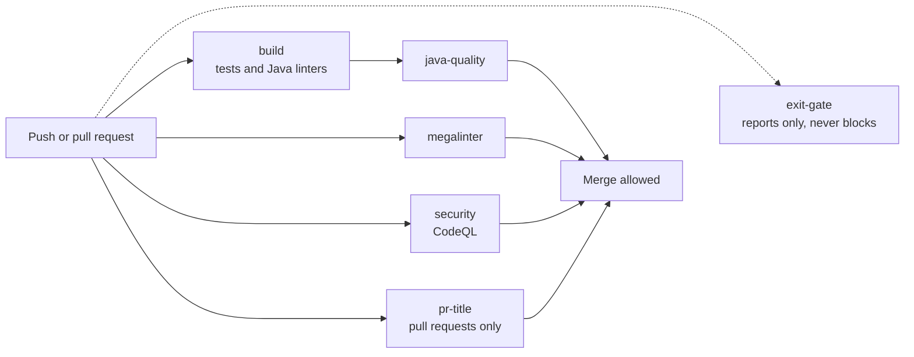

# staybook

Staybook is a hotel booking system, like Booking.com or Airbnb. Each level is built by hand.
The point is to learn system design by meeting each problem for real and fixing it, not by reading about it.


- [Level 0 architecture](docs/architecture/level-0.md) covers the
  requirements, actors, modules, flows, and the payment gateway.
- [Level 0 data model](docs/architecture/data-model.md) covers the
  tables, the rules the schema enforces, booking states, and money and
  time.

[`docs/architecture/`](docs/architecture/) holds snapshots of the design board.

## CI

[](https://github.com/AshwinM-134/staybook/actions/workflows/ci.yml?query=branch%3Amain)
[](https://github.com/AshwinM-134/staybook/actions/workflows/ci.yml?query=branch%3Amain)
[](https://github.com/AshwinM-134/staybook/actions/workflows/ci.yml?query=branch%3Amain)
[](https://github.com/AshwinM-134/staybook/actions/workflows/ci.yml?query=branch%3Amain)
[](https://github.com/AshwinM-134/staybook/actions/workflows/ci.yml?query=branch%3Amain)

Each badge shows the latest result of that check on `main`.



`build`, `java-quality`, `megalinter`, `security`, and `pr-title` must
pass before a pull request can merge. `pr-title` runs only on pull
requests, so it has no badge for `main`. `exit-gate` runs the level 0
exit-gate tests and never blocks a merge. It stays red until
`V1__init.sql` and the [HTTP contract](docs/levels.md#http-contract) are
in place.

[`CONTRIBUTING.md`](CONTRIBUTING.md#ci) lists what each job runs. It
also has the commit and pull request rules.

## Running locally

You need:

- JDK 21. CI uses Temurin 21. `./mvnw` downloads Maven, so you do not
  need to install it.
- Docker with Compose. The tests start their own Postgres through
  Testcontainers, so `./mvnw verify` needs Docker too.

Start Postgres and the mock gateway. `--wait` returns when both
healthchecks pass:

```bash
docker compose up -d --wait
```

Run the app against that Postgres with the `dev` profile. The `dev` and
`test` profiles use the database password `staybook` unless
`DB_PASSWORD` is set, and `test-webhook-secret` unless
`STAYBOOK_PAYMENT_WEBHOOK_SECRET` is set. Any other profile has no
fallback for either and does not start without both:

```bash
./mvnw spring-boot:run -Dspring-boot.run.profiles=dev
```

`src/main/resources/db/migration` holds only a `.gitkeep`. Ash's real
schema is the first migration, `V1__init.sql`, and Flyway applies it on
startup. Until then Flyway logs `No migrations found` and the app still
starts.

Default tests, linters, and formatter check:

```bash
./mvnw verify
```

The smoke test boots Spring against Postgres via Testcontainers. Tags
`level0`, `level2`, and `level3` are excluded, so this stays green.

Run one level on its own. Level 0 fails until the
[HTTP contract](docs/levels.md#http-contract) is implemented:

```bash
./mvnw verify -Dgroups=level0 -DexcludedGroups=
```

The `exit-gate` job runs the same command.
[`docs/levels.md`](docs/levels.md) is the level guide. It has the level 0
design, the HTTP contract the exit gates call, and the levels in order.

`./mvnw verify` runs PMD, Checkstyle (Google style), SpotBugs, and
Spotless. Format Java with:

```bash
./mvnw spotless:apply
```

## License

MIT. See [`LICENSE`](LICENSE).
