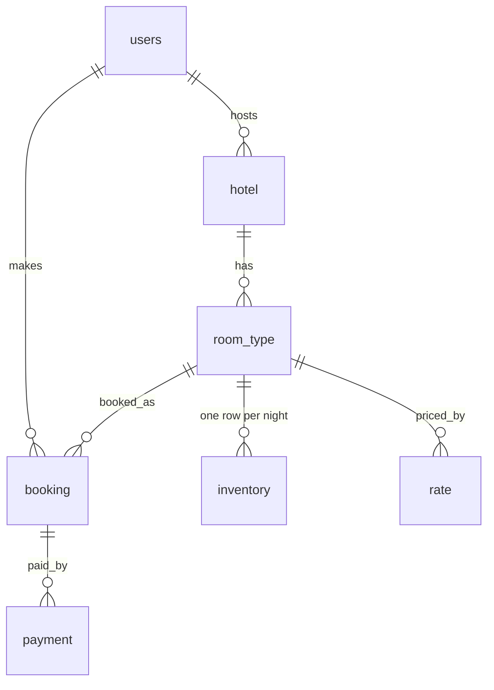
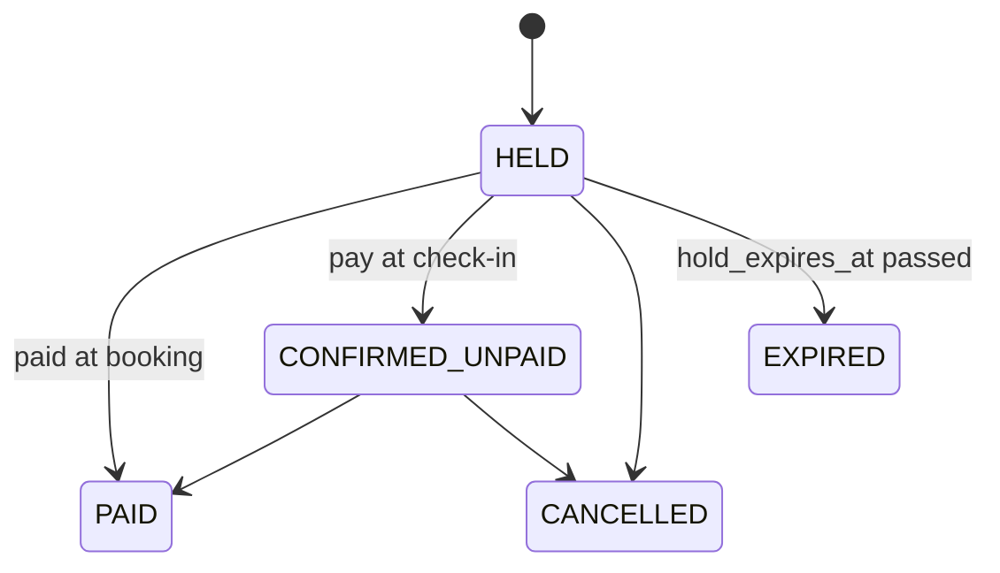

# Level 0 data model

This page describes the shape of the data and the rules the schema enforces. `V1__init.sql` is the source of truth. If the two ever disagree, the migration wins and this page gets fixed.

## Tables

| Table | Holds | Points to |
| --- | --- | --- |
| `users` | guests and hosts | |
| `hotel` | a property | its host in `users` |
| `room_type` | a kind of room in a hotel | `hotel` |
| `inventory` | how many rooms of a type exist and are reserved on one night | `room_type` |
| `rate` | the per-night price for a room type | `room_type` |
| `booking` | one guest's stay in one room type | `users`, `room_type` |
| `payment` | one payment attempt for a booking | `booking` |

## Rules the schema enforces

- `inventory` has one row per room type per night. Its primary key is `(room_type_id, date)`, and `CHECK (reserved >= 0 AND reserved <= total)` holds on every row.
- `booking.idempotency_key` is unique. The booking also stores a `request_hash`. A repeated key with a different hash is rejected with 422.
- `payment.provider_ref` and `payment.idempotency_key` are unique. A payment reaches its user through its booking, so `payment` has no `user_id`.
- Deleting a room type never removes its bookings. The foreign key from `booking` to `room_type` must not cascade.

## Booking states

- Holding rooms adds 1 to `reserved` for each night in one statement guarded by `reserved < total`. The hold succeeds only if the number of rows updated equals the number of nights.
- Releasing a hold changes the status with `WHERE id = :id AND status = 'HELD'`. Inventory is given back only if that update changed exactly one row, so a release can never happen twice.

## Money and time

- Every amount is a whole number of paise: `bigint` in the database and `long` in Java. The field name says the unit, as in `total_price_paise` and `amount_paise`. ₹1500 is `150000`.
- Business times such as `hold_expires_at` come from the injected `Clock`, never from `now()`. Record-keeping columns such as `created_at` may use `DEFAULT now()`.
